# Database

All tables of the Hunt Hub database (PostgreSQL 16 with PostGIS) and how they relate. The schema is defined with Drizzle in [`backend/src/db/schema/`](../backend/src/db/schema/) and changed only through the numbered migrations in [`backend/drizzle/`](../backend/drizzle/) (0000 to 0014). A shorter diagram with only the core tables is in the [backend README](../backend/README.md#schema-overview).

The diagram shows primary keys (PK), foreign keys (FK) and the columns that matter for understanding the model. The table list after it says what each group is for.

## Diagram

```mermaid
erDiagram
  ESTATES ||--o{ USERS : "managers, staff, guests"
  ESTATES ||--o{ AREAS : has
  ESTATES ||--o{ EVENTS : plans
  ESTATES ||--o{ GUEST_GROUPS : has
  ESTATES ||--o{ TEMPLATES : has
  ESTATES ||--o{ HUNTING_LICENSES : "scopes"
  ESTATES ||--o{ TRAINING_CERTIFICATES : "scopes"
  ESTATES ||--o{ DOCUMENT_REJECTIONS : "scopes"

  USERS ||--o| ACCOUNTS : "login"
  USERS ||--o| CONTACTS : "guest details"
  USERS ||--o{ USER_AUTH_TOKENS : "activation, reset, invitation"
  USERS ||--o{ TOTP_BACKUP_CODES : "admin 2FA"
  USERS ||--o{ MOBILE_SESSIONS : "iPhone logins"
  USERS ||--o{ SYNC_MUTATIONS : "offline changes"
  USERS |o--o{ AUDIT_LOGS : "actions"

  AREAS ||--o{ STANDS : contains

  EVENTS ||--o{ DRIVES : "split into"
  EVENTS ||--o{ INVITATIONS : has
  USERS ||--o{ INVITATIONS : "guest receives"
  USER_AUTH_TOKENS ||--o{ INVITATIONS : "link token"

  DRIVES ||--o{ DRIVE_GROUPS : has
  USERS |o--o{ DRIVE_GROUPS : "leads"
  DRIVES ||--o{ DRIVE_STAND_ASSIGNMENTS : uses
  STANDS ||--o{ DRIVE_STAND_ASSIGNMENTS : "assigned in"
  DRIVE_GROUPS |o--o{ DRIVE_STAND_ASSIGNMENTS : "group"
  USERS |o--o{ DRIVE_STAND_ASSIGNMENTS : "hunter"

  TEMPLATES ||--o{ TEMPLATE_GROUPS : has
  TEMPLATES ||--o{ TEMPLATE_STAND_ASSIGNMENTS : has
  STANDS ||--o{ TEMPLATE_STAND_ASSIGNMENTS : "assigned in"
  TEMPLATE_GROUPS |o--o{ TEMPLATE_STAND_ASSIGNMENTS : "group"

  GUEST_GROUPS ||--o{ GUEST_GROUP_MEMBERS : contains
  USERS ||--o{ GUEST_GROUP_MEMBERS : "belongs to"

  USERS ||--o{ HUNTING_LICENSES : "guest uploads"
  HUNTING_LICENSES ||--o{ HUNTING_LICENSE_ATTACHMENTS : files
  USERS ||--o{ TRAINING_CERTIFICATES : "guest uploads"
  TRAINING_CERTIFICATES ||--o{ TRAINING_CERTIFICATE_ATTACHMENTS : files
  USERS ||--o{ DOCUMENT_REJECTIONS : "guest gets"

  ESTATES {
    int id PK
  }
  USERS {
    int id PK
    int estate_id FK "null only for admins"
    enum role "admin, manager, staff, guest"
    string first_name
    string last_name
  }
  ACCOUNTS {
    int user_id PK, FK
    boolean active
    int failed_attempts
    timestamp locked_until
    string totp_secret
    string wfs_token "QGIS access"
  }
  CONTACTS {
    int user_id PK, FK
    date date_of_birth
    int rating
  }
  USER_AUTH_TOKENS {
    int id PK
    int user_id FK
    enum type "activation, password_reset, invitation"
    timestamp expires_at
  }
  TOTP_BACKUP_CODES {
    int id PK
    int user_id FK
    string code_hash
    timestamp used_at
  }
  MOBILE_SESSIONS {
    int id PK
    int user_id FK
    string access_token_hash
    string refresh_token_hash
    timestamp revoked_at
  }
  SYNC_MUTATIONS {
    uuid id PK "sent by the app"
    int user_id FK
    string type
    json result
  }
  SYNC_TOMBSTONES {
    int entity_id
    int estate_id "no FK: the estate may be gone"
    timestamp deleted_at
  }
  AUDIT_LOGS {
    int id PK
    int user_id FK "set null"
    string event
    json metadata
  }
  RATE_LIMITS {
    string key PK
    int hits
    timestamp reset_at
  }
  SESSION {
    string sid PK
    json sess
    timestamp expire
  }
  AREAS {
    int id PK
    int estate_id FK
    string name
    geometry geofile "PostGIS MultiPolygon, WGS 84"
    timestamp updated_at "cache key"
  }
  STANDS {
    int id PK
    int area_id FK
    string number
    geometry location "PostGIS Point, WGS 84"
    enum status "ok, needs_repair, broken, removed"
    date status_date
  }
  EVENTS {
    int id PK
    int estate_id FK
    string event_name
    date date
  }
  DRIVES {
    int id PK
    int event_id FK
    string name
    time start_time
    time end_time
  }
  DRIVE_GROUPS {
    int id PK
    int drive_id FK
    int leader_id FK "set null"
  }
  DRIVE_STAND_ASSIGNMENTS {
    int id PK
    int drive_id FK
    int stand_id FK
    int drive_group_id FK "set null"
    int user_id FK "set null"
  }
  TEMPLATES {
    int id PK
    int estate_id FK
    string name
  }
  TEMPLATE_GROUPS {
    int id PK
    int template_id FK
  }
  TEMPLATE_STAND_ASSIGNMENTS {
    int id PK
    int template_id FK
    int stand_id FK
    int template_group_id FK "set null"
  }
  INVITATIONS {
    int id PK
    uuid public_id "the magic link"
    int event_id FK
    int user_id FK
    int token_id FK
    enum status "staged, sent_email, sent_manually, waitlist, archived"
    enum response "open, yes, no"
    timestamp respond_by
  }
  GUEST_GROUPS {
    int id PK
    int estate_id FK
    string name
  }
  GUEST_GROUP_MEMBERS {
    int id PK
    int group_id FK
    int user_id FK
  }
  HUNTING_LICENSES {
    int id PK
    int estate_id FK
    int user_id FK
    boolean checked
    date expiry_date
  }
  HUNTING_LICENSE_ATTACHMENTS {
    int license_id FK
  }
  TRAINING_CERTIFICATES {
    int id PK
    int estate_id FK
    int user_id FK
    boolean checked
    date issue_date
  }
  TRAINING_CERTIFICATE_ATTACHMENTS {
    int cert_id FK
  }
  DOCUMENT_REJECTIONS {
    int id PK
    int estate_id FK
    int user_id FK
    enum kind "licence, certificate"
    string reason
  }
```

## Tables by purpose

| Group | Tables | What they are for |
|---|---|---|
| Tenant and people | `estates`, `users`, `accounts`, `contacts` | Every estate is a separate customer. Users have one role; admins have no estate. Admins, managers and staff log in with an `accounts` row; guests have none and use their invitation link |
| Login and security | `session`, `user_auth_tokens`, `totp_backup_codes`, `mobile_sessions`, `rate_limits`, `audit_logs` | Web sessions (connect-pg-simple), one-time tokens, admin 2FA backup codes, iPhone app tokens (stored as hashes), rate-limit counters shared by all instances, and the audit log |
| Areas and stands | `areas`, `stands` | Geographic data in PostGIS (WGS 84). `areas.updated_at` is changed by a trigger and is the key of the boundary cache |
| Hunts | `events`, `drives`, `drive_groups`, `drive_stand_assignments` | A hunt (event) is split into drives; groups and stand assignments per drive are in the schema, the screens for them are planned (HUN-91) |
| Drive templates | `templates`, `template_groups`, `template_stand_assignments` | Reusable drive set-ups; schema only, not used by the app yet (HUN-91) |
| Guests and invitations | `invitations`, `guest_groups`, `guest_group_members` | Who is invited to which hunt, the state of the invitation and the guest's answer; reusable groups of guests |
| Guest documents | `hunting_licenses`, `hunting_license_attachments`, `training_certificates`, `training_certificate_attachments`, `document_rejections` | Licences and certificates with their files (stored in R2), whether they were checked, and rejections with the reason shown to the guest |
| Mobile sync | `sync_mutations`, `sync_tombstones` | Offline changes from the iPhone app, applied exactly once, and deleted areas and stands so the app can remove them (written by triggers) |

## Rules the database enforces

- **Cascades:** deleting an estate removes its areas, events, groups, templates and documents; deleting an area removes its stands; deleting an event removes its drives and invitations; deleting a user removes their login data, tokens and documents.
- **Set null instead of delete:** audit log entries, drive group leaders and assignments keep existing when a user is deleted.
- **Checks:** every user except admins must belong to an estate (`estate_id_required_for_non_admin`).
- **Unique:** an invitation's `public_id` (the magic link) is unique.
